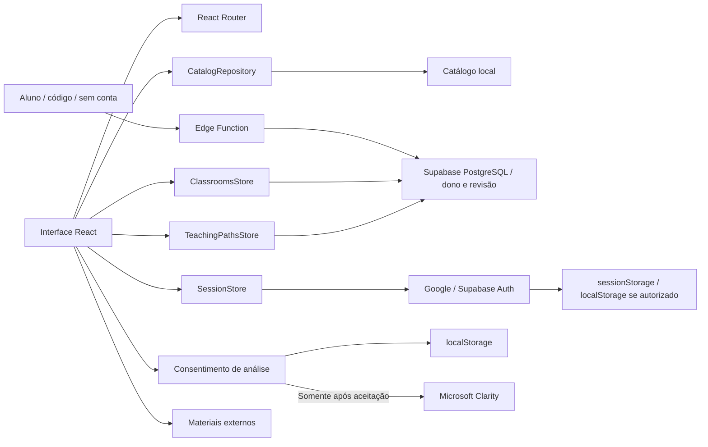
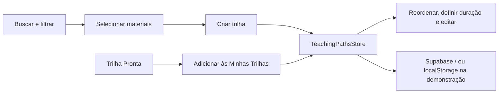

# Arquitetura da plataforma

## Visão geral

O Explora Computação é uma SPA estática construída com React, TypeScript e
Vite, com Supabase Auth, PostgreSQL e uma Edge Function. O catálogo permanece
local ao projeto; turmas e trilhas pessoais online pertencem à conta docente.
O modo demonstrativo usa o navegador, sem importar esses dados para contas.



## Organização

```text
.
├── .github/workflows/       # validação e deploy automático
├── config/                  # Vite, Vitest, Playwright e ESLint
├── docs/                    # TCC, curadoria e documentação técnica
├── public/                  # imagens e identidade visual
├── src/
│   ├── app/                 # composição de rotas
│   ├── components/          # componentes compartilhados
│   ├── data/                # catálogo local curado
│   ├── domain/              # tipos e validações de domínio
│   ├── features/            # funcionalidades por contexto
│   ├── lib/                 # utilitários e integração de análise de uso
│   ├── repositories/        # limite de acesso ao catálogo
│   ├── store/               # sessão, trilhas pessoais e turmas
│   ├── styles/              # tokens e estilos globais
│   └── test/                # configuração comum de testes
└── tests/e2e/               # fluxos reais no Playwright
```

As features principais expõem sua API pública em `index.ts`. Componentes compartilhados do
catálogo — diálogo acessível, estados de carregamento e apresentação de
metadados — continuam disponíveis para Buscar Materiais, Trilhas Prontas e
Minhas Trilhas.

## Decisões principais

### Rotas por hash

O `createHashRouter`, com `RouterProvider`, mantém a rota depois de `#` e permite
interromper a navegação com `useBlocker` quando uma trilha tem alterações pendentes.
O fechamento ou recarregamento da aba usa `beforeunload`. Como o fragmento não
é enviado ao servidor, atualizar uma tela interna não depende de regras de reescrita no
GitHub Pages.

As rotas atuais são Buscar Materiais, detalhe do material, Trilhas Prontas,
Minhas Trilhas, Minhas Turmas, Sobre e as páginas públicas Privacidade e
Acessar turma. URLs antigas de acervo, pastas e planos apenas
redirecionam para um fluxo atual e não carregam módulos legados.

`TeachingMaterialBrowser` compartilha os filtros e as prévias entre **Buscar
Materiais** e a janela `TeachingPathMaterialPicker` de **Minhas Trilhas**. Na
janela, os cartões permitem seleção múltipla; na busca, mantêm os links e as
ações de criação/adição existentes. A seleção da janela altera somente o
rascunho da trilha aberta. A criação solicita nome, objetivo, cor e ícone antes
de persistir. A saída da conta também permite que o editor confirme o descarte
antes de limpar a sessão, por `requestWorkspaceExit`.

`BnccSkillFilter` reúne os códigos e textos dos vínculos curriculares do acervo,
sem duplicar habilidades compartilhadas por vários materiais ou anos. A seleção
aceita qualquer habilidade escolhida, mas exige que ela esteja associada a um dos
anos selecionados no mesmo vínculo. O catálogo curricular permanece inalterado.

**Minha conta** é um painel compacto no nome/avatar do professor, fora da
navegação principal. Apresenta identificação, o link público de privacidade e
saída. Fecha ao clicar fora, sair pelo teclado ou pressionar Escape; no celular,
Escape fecha primeiro a conta e preserva o menu lateral. O endereço antigo
`/app/perfil` redireciona para Buscar Materiais. Não há página de perfil com
atalhos ou contadores duplicados.

### Caminho-base configurável

O Vite lê `VITE_BASE_PATH`. Localmente o valor padrão é `/`; no workflow ele é
`/<nome-do-repositorio>/`. O helper `publicAsset` aplica `BASE_URL` aos ativos
da pasta `public`, evitando links quebrados no Pages.

### Turmas e acesso dos alunos

`useClassroomsStore` guarda os metadados da turma, o código, o arquivamento e uma
lista ordenada de identificadores de materiais, com visibilidade e orientação.
A visibilidade começa ativa e pertence à associação material/turma. Adicionar
novamente um material existente não o duplica nem altera uma ocultação anterior.
O código permanece ao editar ou arquivar. Excluir reserva o código antigo para
não associá-lo acidentalmente a outra turma.

`sharedPaths` guarda cópias independentes de trilhas em cada turma, separadas
dos materiais avulsos. Cada cópia contém a ordem das etapas, duração, identidade
visual e referência à versão de origem. A ausência desse campo mantém
compatibilidade com registros antigos. No modo online, sua presença também
identifica que o backend já aceita o compartilhamento. Na demonstração,
registros antigos recebem a lista ao compartilhar a primeira trilha.

O professor pode compartilhar, atualizar a cópia, alterar sua visibilidade,
remover ou ordenar as trilhas da turma. São apresentadas antes dos materiais
avulsos; cada grupo mantém sua ordem própria. A edição e a exclusão da original
não alteram as cópias. `StudentClassroom` e `StudentTeachingPath` descrevem a
projeção pública, com nome, aparência e IDs das etapas, sem metadados docentes.

As rotas docentes `/app/minhas-turmas` e `/app/minhas-turmas/:classroomId` usam a
conta do professor no modo online. `/alunos` é pública e não usa `signIn`, não pede dados
de estudantes e não persiste a turma escolhida em cookies, URL ou armazenamento.
Recarregar ou reabrir a entrada exige informar o código novamente.
Depois de entrar, a visualização usa a rota genérica `/alunos/atividades`, sem
identificar a turma na URL. O favorito continua apontando para `/alunos`, que
limpa a seleção anterior mesmo quando a visualização já está aberta.

No modo online, `TeacherWorkspaceRepository` usa RPCs com dono e revisão.
Gravações só alteram o store após confirmação. Trocar de conta limpa os stores e
invalida respostas antigas. `StudentClassroomRepository` consulta apenas a Edge
Function, sem token de professor; materiais ocultos são retirados no servidor.
A tela do aluno atualiza a cada 20 segundos enquanto visível e ao recuperar foco.
No modo demonstrativo, o evento `storage` sincroniza as abas locais.
Configuração, permissões e testes estão em [backend-supabase.md](backend-supabase.md).

### Repositório de catálogo

A interface consome `CatalogRepository`, atualmente implementado por
`LocalCatalogRepository`. O backend registra somente os IDs válidos, preservando
a curadoria no código e sem permitir inclusão de materiais pelos professores.

Os anos escolares aceitos são centralizados em `SUPPORTED_GRADES`. O currículo
de um recurso associa ano, eixo, objeto, habilidade e competências, além da
origem e do estado do mapeamento. Os filtros consultam esses alinhamentos sem
combinar indevidamente uma habilidade com um ano ao qual ela não foi associada.

Na ficha e na proposta de atividade, as referências curriculares aparecem como
**Habilidades da BNCC**. Na ficha, o campo `topic` aparece como **Assunto**, antes
das habilidades, e continua usado na busca e como alternativa para objetivos.
Esse tema curatorial não substitui o objeto de conhecimento dos alinhamentos.
O filtro **Assuntos** usa suas próprias palavras-chave padronizadas, que podem
ser mais amplas que o tema principal da ficha. Essa apresentação não altera os
dados curriculares nem o formato das trilhas salvas.

O catálogo é composto em `src/data/resources.mock.ts`. Coleções ficam separadas
por origem em `src/data/resources/`, e os textos da BNCC e o helper de criação
dos alinhamentos ficam em `src/data/bnccComputing.ts`.

`src/domain/materialType.ts` define os cinco tipos de material e os dois grupos
organizadores da janela de seleção. A composição do catálogo aplica
`src/data/materialTypes.ts`, permitindo vários tipos por cadastro. A busca usa
união entre os tipos selecionados e interseção com os outros filtros, sem
duplicar recursos. A apresentação dos tipos é compartilhada entre fichas,
trilhas e turmas; o campo legado `type` continua disponível para os metadados
pedagógicos. Critérios em `classificacao-tipos-materiais.md`.

Imagens licenciadas ficam em `public/images/cards/`, com miniaturas reduzidas
para a interface. Materiais sem permissão verificada para reutilização de imagem
usam o placeholder do projeto.

### Trilhas de ensino



`useTeachingPathsStore` persiste somente os identificadores dos materiais, os
metadados visuais da trilha e a duração escolhida para cada etapa. Os dados dos
materiais continuam vindo do catálogo, evitando snapshots duplicados.

As Trilhas Prontas usam os mesmos recursos e, quando copiadas, produzem um
registro comum no store. Assim, Minhas Trilhas não precisa distinguir a origem
da sequência para permitir edição. A curadoria fica em
`src/features/ready-teaching-paths/data/readyTeachingPaths.ts`. Cada etapa pode
informar de uma a três aulas; a ausência indica uma aula. O total exibido é
calculado pela soma das etapas, e a cópia preserva essas durações.

Favoritos, pastas e planos de aula não possuem store, domínio ou feature na
versão atual. Chaves antigas no `localStorage` são ignoradas.

### Análise de uso com consentimento

`src/lib/clarity.ts` concentra o ID público, a escolha do visitante, o carregamento
assíncrono e os eventos sem texto livre. `AnalyticsConsent` sincroniza a escolha
e a área visitada. `PrivacyPage` oferece informações e revogação sem autenticação.

O rastreador só é baixado em produção, com ID válido e aceitação. A revogação
nega o consentimento e recarrega o documento para encerrar também eventuais
reinícios do SDK sem cookies. Outras abas recebem a mudança pelo evento
`storage`. As rotas por hash são etiquetadas com valores fixos e eventos de
visita; isso não transforma essas rotas em pageviews nativos distintos.

Os nomes e objetivos das trilhas, além das mensagens que os reproduzem, têm
mascaramento explícito. Campos digitados são mascarados pelo Clarity. A integração
mantém `ad_Storage` negado. O detalhamento está em `integracao-clarity.md`.

## Qualidade

- TypeScript em modo estrito para contratos e dados;
- ESLint para consistência e regras de React;
- Vitest e Testing Library para domínio, estado e componentes;
- Playwright em perfis desktop e mobile para os fluxos completos;
- axe-core para detectar violações automáticas de acessibilidade;
- GitHub Actions bloqueia o deploy se alguma verificação falhar.

## Evolução prevista

Backend, identidade, autorização e persistência remota devem continuar fora dos
componentes de apresentação. Novas áreas precisam ser introduzidas como features
com rota, domínio e testes próprios, evitando reativar código histórico sem uma
decisão explícita de produto.
